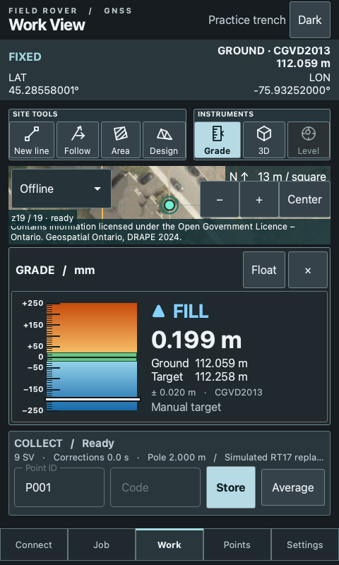
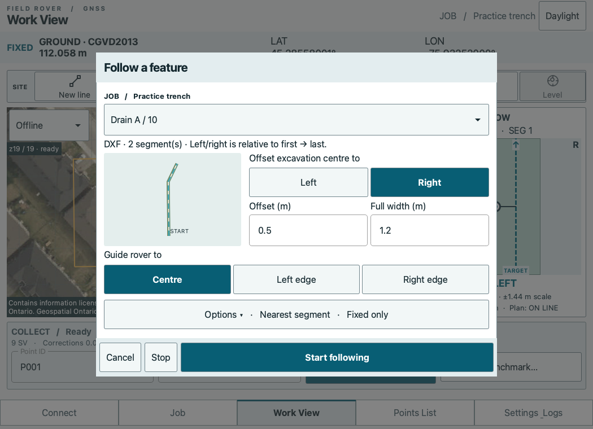
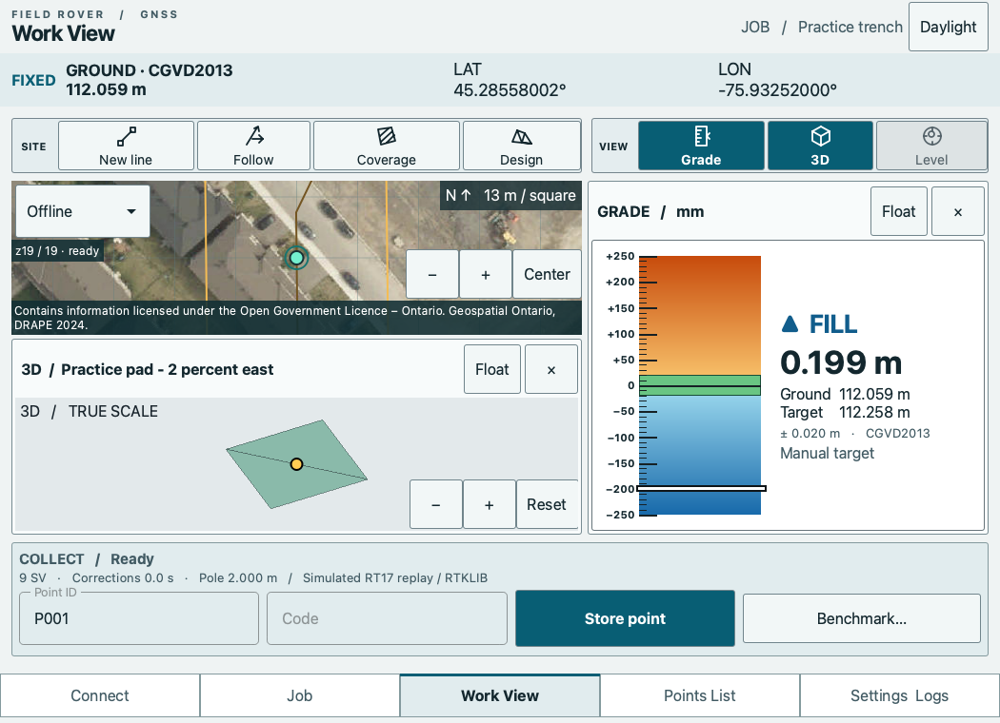
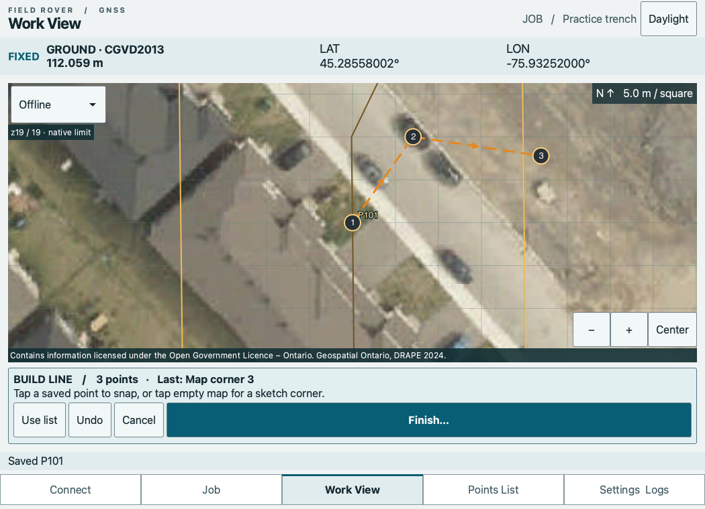

# Field Rover

Field Rover turns a tablet or laptop into a **survey data collector for the Trimble 5700**. The receiver supplies dual-frequency GPS observations over a serial cable; Field Rover combines them with an NTRIP base stream to compute an RTK position on the device. Use it to collect points, average benchmarks, and compare ground elevation with a grading design.

Built with **C++17 and Qt Quick** for Android, Linux, Windows, and macOS. A bundled practice rover, design surface, and aerial map let you try the field workflow without hardware or a caster account.


*The simulated rover needs 0.200 m of fill to reach the manual elevation target and is 0.500 m left of the offset excavation centre. Grade and horizontal guidance are shown together.*

## In the field

- **Collect points and benchmarks.** Store one fresh epoch with a tap, or hold the pole stationary for a timed occupation. Each record keeps its fix quality, base, antenna setup, and height reference. Jobs are saved locally in SQLite and export to CSV.
- **Follow a grade.** Enter a target elevation or load a metric LandXML triangle mesh. The gauge shows how much to **cut** or **fill** after subtracting pole height. It clears when the position goes stale or the rover leaves the surface.
- **Build a measured surface.** Enable survey coverage in Work View to mark each stored shot with a sampling footprint. Review the included points, preview the triangles and export the surveyed ground as LandXML.
- **Follow a feature or trench edge.** Build a line by tapping the map or selecting stored points in order—no coordinate-system entry required. Import straight DXF linework, choose Left or Right, and set the excavation offset and full width. The line-follow graphic shows the rover, target and trench boundaries beside the grade gauge. [Try the practice trench](docs/field-guide.md#follow-the-practice-trench).
- **Work without a basemap connection.** Use a local grid or import raster MBTiles for the job. OpenStreetMap streets and online imagery are optional; missing tiles never block capture. Live NTRIP corrections still require a connection to the caster.
- **Choose the instruments you need.** The icon toolbar separates site tools from instrument toggles. Keep latitude, longitude, and ground elevation visible while docking or floating the gauge and 3D surface preview. A device bubble level is available on supported hardware. Switch between Daylight, Dark, and system appearance.

## Screenshots

Captured from the current native macOS build using the bundled practice rover and offline aerial map. Portrait captures demonstrate the responsive layout, not a physical tablet test.

| Dark mode · portrait | Follow setup · explicit side and target choices |
| --- | --- |
|  |  |

| Docked grade and 3D instruments | Build a line on the map |
| --- | --- |
|  |  |

The same setup dialog [adapts to a smaller screen](docs/screenshots/follow-setup-compact.png) while keeping its action buttons visible. The [3D preview can also float](docs/screenshots/surface-preview.png) independently of Work View.

## Try the grading walk

1. In **Connect**, choose **Continue to Job**. Create a practice job with antenna `Synthetic ARP` and a vertical pole height of **2.000 m**.
2. Open **Job → Grade & surface setup → Design surface → Practice surface**. Set the tolerance to **0.020 m** and tap **Use design**.
3. In **Connect**, tap **Start grading walk (36 s)** and watch **Work View**. The simulated rover crosses a 2% slope: **CUT ~0.200 m → ON GRADE → FILL ~0.200 m → Outside design surface**.

To see the imagery pictured above, select **Settings & Logs → Use practice-pad orthophoto (offline)**, then **Offline** on the map. For live equipment, see [connecting a receiver and RTK2go](docs/field-guide.md#connect-a-receiver).

## Build and test

The [GitHub Actions workflow](.github/workflows/build.yml) builds desktop applications and an Android arm64 debug APK (Android 9 / API 28 or later). Build artifacts are attached to successful [workflow runs](https://github.com/DemiLovato69/rover-view/actions/workflows/build.yml).

For a desktop build, install a C/C++17 toolchain, CMake 3.24+, Ninja, Qt 6.5+ with the [required modules](docs/field-guide.md#build-targets), and PROJ with TIFF support. On macOS with Homebrew, `brew install qt proj cmake ninja` supplies the dependencies. From the repository root:

```sh
cmake -S . -B build/desktop -G Ninja -DCMAKE_BUILD_TYPE=Release
cmake --build build/desktop --parallel
ctest --test-dir build/desktop --output-on-failure
```

Launch with `open build/desktop/bin/fieldrover.app` on macOS or `./build/desktop/bin/fieldrover` on Linux. The first configure downloads pinned RTKLIB sources and a checksum-verified Canadian geoid grid. See the [platform build instructions](docs/field-guide.md#build-targets) for Windows and Android, or the [mock serial walkthrough](docs/field-guide.md#test-the-serial-connection-and-ntrip-client) to exercise the receiver protocol locally.

## Field validation and attribution

The screenshots show **simulated observations**, not a surveyed control point. Desktop tests cover capture, grading, replay, and offline maps. Hardware bench testing demonstrated float RTK; sustained fixed RTK and absolute field accuracy have not been established. Check the antenna reference, coordinate frame, and repeat observations against independent control before relying on field results.

The [field guide](docs/field-guide.md) covers setup, height references, and diagnostics. See [third-party notices](NOTICE.md) for RTKLIB, receiver code, the geoid grid, and map imagery. The aerial screenshots contain Geospatial Ontario DRAPE 2024 imagery licensed under the [Open Government Licence – Ontario](https://www.ontario.ca/page/open-government-licence-ontario).
