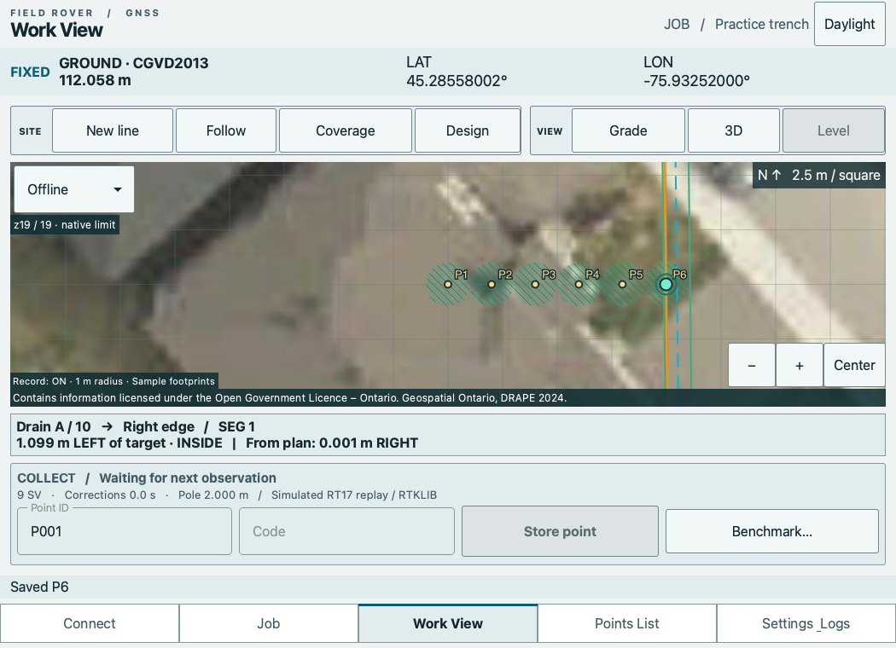
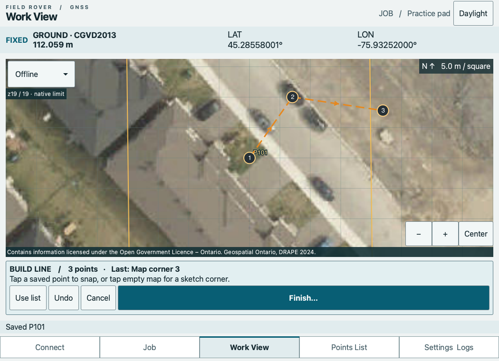

# Field Rover field guide

[Back to the project overview](../README.md)

A touch-first Qt Quick survey collector for a Trimble 5700. The 5700 supplies dual-frequency GPS observations over serial. The application combines them with an NTRIP base in a native RTKLIB solver. The displayed fix is the **app's solution**, not the receiver's autonomous navigation record.

## Run on macOS

From the project directory:

```sh
brew install qt proj cmake ninja
cmake -S . -B build/mac -G Ninja
cmake --build build/mac --parallel
open build/mac/bin/fieldrover.app
```

The Mac development bundle uses the installed Qt and PROJ libraries. The first configure downloads the pinned RTKLIB sources and checksum-verified geoid grid. No Python interpreter or testing checkout is required by the application.

**Quick walkthrough, no equipment:**

1. Start in **Connect**. Tap **Start offline practice (90 s)** or continue to **Job** without a fix. Practice observations pass through the real solver.
2. In **Job**, resume a saved job or create `Practice` with `Synthetic ARP` and a **2.000 m** vertical pole height. Check antenna setup, reference frame, design and imagery before entering **Work View**.
3. In **Work View**, tap **Store point**. The ID advances on save. The position strip always shows latitude, longitude and the selected ground elevation reference, even with the grade gauge visible. Last-known readings show their age. An unavailable CGVD2013 elevation is not replaced with ellipsoid height.
4. Open **Points List** to inspect points and benchmark epochs or export CSV. Visit **Settings & Logs** for display settings, maps, receiver diagnostics and the current session's timestamped events. Changing screens does not stop collection or discard an occupation.

**Customize Work View:** The toolbar separates **site tools** (New line, Follow, Coverage, Design) from **view controls** (Grade, 3D, Level). Grade and 3D each start docked. Tap **Float** in either panel to move it to a separate desktop window or a movable in-app panel on tablets. Tap **Dock** to bring it back. Placement is remembered independently for each instrument. Hiding or moving the gauge does not change its target or what gets stored. A loaded LandXML design appears at true vertical scale; drag to orbit, pinch or tap to zoom. **Load design for preview only** preserves an existing manual grade target.

Use the appearance button in the header or **Settings & Logs** to select **Auto**, **Daylight**, or **Dark**. Auto follows system appearance. Display preferences survive restart. A sensor-equipped tablet can put a bubble beside the grade readout. In Settings, hold the tablet stationary and zero it with its rigidly attached pole independently plumb. Recalibrate after a mount change; calibration is stored for the sensor and orientation. A handheld tablet measures device tilt only. This instrument never applies a tilt correction to a surveyed point.

### Try cut/fill grading

The vertical gauge has a fixed ±250 mm scale, with 10 mm ticks and numbered 50 mm graduations. Above the zero line is **CUT** (orange); below it is **FILL** (blue). The green band marks the configured tolerance. Outside the scale the pointer stays at the end, while the readout gives the full difference in metres. If guidance becomes unavailable the pointer disappears. Point ID, code and **Store point** sit in a fixed capture panel in either orientation.

1. Create or open a practice job with a **2.000 m** vertical pole height. In **Work View → Design** (or **Job → Grade & surface setup**), select **Design surface → Practice surface**. Set tolerance to **0.020 m**, then tap **Use design**.
2. In **Connect**, disconnect any previous session and tap **Start grading walk (36 s)**. The synthetic rover moves east at 1 m/s. Expect **CUT ~0.200 m** at the start, **ON GRADE** near 10 s, **FILL ~0.200 m** near 20 s, and **Outside design surface** after crossing the east edge. The same walk is available through a mock serial port with `python3 tools/mock5700.py --walk`.
3. To try a constant elevation, use the **stationary** practice replay instead. Choose **Grade… → Manual target**, enter **112.258 m**, and select **CGVD2013**. Ground should be about **112.058 m** and the instruction **FILL 0.200 m**. Positive ground-minus-design means cut; negative means fill. The numerical value is the full difference even when the visual bar reaches its end.

[practice-pad.landxml](../fixtures/practice-pad.landxml) is also a standalone file for **Open LandXML file…**. It defines a 40 × 40 m pad in EPSG:2959, rising 2% east. The importer reads named LandXML TIN surfaces in metres with a declared NAD83(CSRS) UTM EPSG code (zones 7–24N) and `verticalCoordinateSystemName` of `CGVD2013` or `Ellipsoid`. Choose a named surface and confirm the rover's frame matches before applying it. TIN vertices use **northing, easting, elevation** order. Only visible triangles supply elevations; edges are included, gaps aren't interpolated. Export explicitly clipped boundaries as clipped triangles first. The import limit is 16 MiB.

The active job stores its settings and a copy of the imported XML. The bar uses **ground height**, not antenna height. It clears the instruction when the epoch is stale, quality drops below the selected threshold (fixed by default), height is unavailable, or the rover leaves the TIN. Stored ordinary points and their CSV rows retain grade status, datum, tolerance, measured ground, target and signed difference when available, plus surface identity for a design job.

### Basemaps in the field

See also: [survey coverage and measured-ground export](#survey-coverage-and-measured-ground-export) and [feature-line guidance](#follow-the-practice-trench).

Choose **Local grid**, **Street**, **Satellite**, or **Offline** on the plot. Street uses OpenStreetMap at street scale. In Ontario, Satellite requests the provincial aerial imagery service through zoom 19 (actual resolution and coverage vary); elsewhere the default is the historical NASA regional overview through zoom 12. **Settings & Logs → Online satellite imagery** accepts a licensed HTTPS XYZ template, attribution and maximum native zoom. An endpoint with query parameters is kept for the session only. The map reports native zoom limits rather than claiming extra image detail. Tiles load asynchronously; zooming preserves the location under the zoom gesture. Online maps and RTK corrections have independent status.

For a network-free walkthrough, open a practice job, tap **Settings & Logs → Use practice-pad orthophoto (offline)**, then choose **Offline** in Work View. The bundled [raster MBTiles](../fixtures/practice-aerial.mbtiles) covers the practice pad at zooms 17–19 with DRAPE 2024 aerial photography (see [NOTICE.md](../NOTICE.md)). For another site import a licensed EPSG:3857 raster MBTiles package (JPEG, PNG, or supported WebP) with your coverage. It is copied and checked in the background before replacing the job's previous map. TMS row numbering is the default; explicitly declared XYZ is supported. Check coverage, acquisition date if supplied, size and native zoom before heading out. A missing tile leaves a grid with survey overlays and working capture controls.

**Known-point check:** Reoccupy a saved fixed point or fixed benchmark. In **Settings & Logs**, select it and run the check. A later fresh fixed epoch in the same known frame and from the same base is required. Horizontal geodesic distance and signed ground-height difference (current minus stored) are reported without changing the point, base coordinates or calibration. This is a repeat check, not independent proof of absolute accuracy.

### Delete a stored record

Open **Points List**, tap the record, and choose **Delete point…** or **Delete benchmark…**. Check the ID and job name, then tap **Delete**. A benchmark's accepted epochs are deleted with it. Deletion is permanent, updates the plot and future exports, and does not change previously exported CSV files.

### Survey coverage and measured-ground export

1. Open **Work View → Coverage** (**Area** on the compact toolbar). Enable **Include new stored shots in surface**, set a sampling **radius in metres**, and apply. A radius of 0.50 m gives a 1.00 m diameter. Hatching appears after a successful **Store point**, never just from moving the rover. **Show sample footprints on map** is independent of recording.
2. Radius changes apply to subsequent shots. Open a point in **Points List** to include or exclude it later. An existing footprint keeps its original radius; a point first included later receives the current radius. Benchmarks are excluded unless explicitly included. Check the stored quality of the shots you select: inclusion itself is not an accuracy filter.
3. In **Job → Preview & export surveyed surface**, confirm the job's known reference frame and its NAD83(CSRS) UTM EPSG code, choose **CGVD2013** or **Ellipsoid**, and enter the **maximum triangle edge length**. Tap **Build surface preview**. Ground elevation already accounts for the measured pole height.
4. Review the measured triangles, excluded count and gaps. Tap **Export preview as LandXML…**. This exports the preview, not the active grading design. Changing the points invalidates the preview. The file can be reopened through **Grade & surface setup**.

The footprints describe sample reach; a shot does not measure the elevation of its entire circle. The export uses Delaunay triangles between selected shots and drops triangles exceeding the edge limit. A footprint radius does not invent vertices or clip triangle boundaries. Wide gaps can be excluded with a shorter edge limit; inspect the preview rather than assuming every unsampled area is a hole. At least three noncollinear positions in a common frame with the selected ground height are required. Resolve duplicate horizontal positions by excluding one shot. Feature lines are not automatically used as terrain breaklines.

### Follow the practice trench

1. Create a **practice** job with `Synthetic ARP`, a 2 m pole and frame `Practice NAD83(CSRS) EPSG:2959`. For real jobs use the actual known frame/epoch; the app does not infer a local CAD grid or perform a site calibration.
2. In **Points List → Features → Import DXF…**, tap **Practice DXF** (or open [practice-trench.dxf](../fixtures/practice-trench.dxf)). Select **Drain A**, confirm metres and EPSG:2959, then import. Its first segment runs north across the practice pad.
3. Tap **Drain A / 10** in the list, or select it using **Work View → Follow**. Tap **Right**, enter a **0.50 m** offset and **1.20 m** full width. Choose **Right edge** and tap **Start following**. On the map the arrowed solid line is the plan feature, the dashed line the offset centre, and the paired boundaries the edges. In the **Line Follow** instrument beside the grade gauge, the dashed target stays centred: the circle shows the rover, the shaded band shows the excavation, and the solid line marks the original plan feature. The numerical distance remains exact beyond the graphic’s scale. Segment lock and float acceptance are under **Options**.
4. Start the **grading walk** in Connect. The rover walks east across the trench. Looking from the first vertex toward the last, a rover **0.80 m right of the plan line** is **inside**, **0.30 m right of centre** and **0.30 m left of the right edge**. The reading tells you where the rover *is*, not which way to move. These are projected grid metres. For a centred trench, leave the centre offset at zero and enter its full width.



**Create a line:** Tap **New line** on the map toolbar or **New line from points** in Points List. Tap saved points in the order you want to follow them. On the map, tapping empty space adds an approximate sketch corner; nearby stored points snap, and closely spaced candidates open a picker. Switch with **Use map / Use list** without losing the draft. Tap **Finish**, review or reorder the numbered corners, then **Save line**. You can keep the suggested name. No coordinate-system entry is needed, even for a job without a declared grid.

The app uses a supported job grid when available, otherwise a local metric projection centred on the first vertex. Existing DXF/grid features retain their projection. The line stores a **snapshot** of its vertices and the IDs of any snapped shots; deleting a shot later does not reshape it. A freehand map corner creates neither a measured elevation nor a survey record. DXF import and LandXML export still require the correct external drawing reference.



DXF import supports model-space `LINE`, straight `LWPOLYLINE`, and straight `POLYLINE` / `VERTEX` sequences in text DXF up to 16 MiB. It preserves layer membership, vertex order and closure; separate entities remain separate. Curves (including bulged polylines), blocks, meshes and unsupported entities are skipped, with counts before import. Confirm the drawing's units and projected frame: DXF X is easting and Y is northing. Guidance uses horizontal geometry only. Imports are all-or-nothing and never overwrite an existing same-named feature.

Line guidance defaults to fixed RTK; float is explicit. A stale position or insufficient quality clears live distances while keeping the linework visible. Open lines stop guidance beyond either end. At competing branches, select a specific segment instead of relying on nearest-segment selection. Sharp reversals and locally collapsed offsets are rejected. Turning off line guidance does not turn off grading or point capture. Stored ordinary shots retain the active guide, segment, width, offset and available signed distances in their details and CSV export.

### Test the serial connection and NTRIP client

In another terminal, run:

```sh
python3 tools/mock5700.py
```

The first two lines are a pseudo-terminal path (e.g. `/dev/ttys009`) and a localhost caster URL. In **Connect**, enter the printed serial path, select **Local simulator**, and tap **Connect receiver and base**. If using `--port 0` or another port, paste the printed caster URL. Disconnect any active practice session first. No credentials are needed. Use a separate job for simulated data.

The simulator answers the 9600-baud identity probe, link acknowledgement, satellite/ephemeris requests and multi-page enhanced RT17 observation requests. Its time-matched synthetic base streams valid RTCM3 station coordinates and dual-frequency observations (1005/1004); the field caster uses MSM4. The pseudo-terminal exercises framing and request/response timing, not electrical baud switching. Synthetic results are labeled in the UI, saved records, and CSV.

| Command using the printed simulator PID | Expected result |
|---|---|
| `kill -USR1 PID` | Toggle base transmission. Corrections become stale, then the solver falls back to standalone while rover epochs continue. A benchmark stops counting qualifying time. |
| `kill -USR2 PID` | Toggle repeated rover epochs. The live marker becomes **Last known** and **Store point** is disabled. |
| `kill -HUP PID` | Corrupt the next observation reply. The incomplete epoch is rejected. |
| Ctrl-C in the simulator terminal | Disconnect; existing points remain in the job. |

## Connect a receiver

Use the receiver's serial data collector cable and an appropriate USB-to-RS-232 adapter. Close other serial readers. Select the device in **Connect** (or enter its desktop port path). The app probes at 9600 8N1, validates a 5700 identity, switches to the reported data rate and polls observations without reconfiguring the receiver. Keep the device clock current for the firmware's GPS week rollover correction.

Select **RTK2go · OsgoodeFarms**, enter the rover email and use the tested password `none`; the mountpoint is case-sensitive. The tested endpoint uses unencrypted HTTP. The profile URL is editable for another compatible NTRIP v2 base transmitting GPS observations and station coordinates. Credentials are used in memory, not saved to the job. Receiver status, base-observation status, and fix quality are independent. Corrections are consumed by the app, not sent to the receiver.

On Android, select a supported USB host adapter, grant the system's USB permission, then tap **Connect** again. The USB bridge uses usb-serial-for-android's default driver probe. The physical adapter, tablet power arrangement and detachment/reconnection behavior still need testing on the selected hardware.

## Survey records

- **Point:** one fresh, distinct GPS epoch, with original quality (including standalone/float), coordinates, satellites, available correction age/ratio, source and base information. The local grid plot is for navigation, not a coordinate projection for export.
- **Benchmark:** qualifying duration and individual epochs, averaged in Earth-centered Cartesian coordinates. Horizontal and vertical scatter are population RMS about that mean in the local east/north/up axes. Fixed-only is the default; float can be explicitly included. Gaps and excluded epochs do not advance time. An interrupted receiver session or changed base cannot silently finish the occupation. If the pole moves, discard and restart.
- **Heights:** antenna ellipsoid, ground ellipsoid, and (inside grid coverage) antenna/ground CGVD2013 are separate metre fields. Ground heights subtract the measured vertical ARP offset once. The CGG2013a conversion assumes NAD83(CSRS)v6; record the actual base frame/epoch, or leave it unknown. An antenna model name documents setup; it does not apply a phase-center calibration. Neither ambiguity ratio nor occupation scatter establishes absolute accuracy.
- **Persistence:** each capture is an atomic SQLite insert, including the benchmark's contributing epochs. A setup edit affects future captures only. On macOS the database is `~/Library/Application Support/FieldRover/FieldRover/field.sqlite`; other targets use Qt's application-data directory. Unsaved occupations are not resumed after process exit. CSV exports summaries and provenance; individual accepted benchmark epochs remain in the database.

## Build targets

Use CMake 3.24+, a C/C++17 toolchain, Qt 6.5+ with Quick, Quick Controls, Network, Concurrent, Sensors, SQL/SQLite and (desktop) Serial Port, and PROJ built with TIFF support. Desktop tests additionally use Qt Test. Build commands and target toolchains are in [the build workflow](../.github/workflows/build.yml).

| Target | Build |
|---|---|
| Linux | With the development packages and QML runtime modules installed, `cmake -S . -B build/linux -G Ninja && cmake --build build/linux`. Launch `build/linux/bin/fieldrover`. |
| Windows x64 | Use an MSVC x64 Qt kit and vcpkg `proj[core,tiff]:x64-windows`. Configure with the vcpkg toolchain file and Qt's prefix, then `cmake --build build --config Release`. |
| Android arm64 | Use a matching Qt Android and host kit, Android SDK/NDK, Java 17 and target-built static PROJ/TIFF. Configure using vcpkg's toolchain with the Qt Android toolchain chained beneath it (so TIFF's compression libraries are linked), then build `--target apk`. The workflow gives the exact commands. Min SDK 28. |
| macOS | Development and mock-serial walkthrough above. |

The CI workflow builds desktop targets, runs tests, stages desktop installs, and builds an Android APK. Run it on your repository before distributing a target package.

## Verification

```sh
ctest --test-dir build/mac --output-on-failure
```

Desktop tests load the touch UI and verify geoid conversion, averaging, reopening the database and deterministic replay. The 90 synthetic epochs in `fixtures/practice.bin` are compared with `fixtures/reference.csv`, obtained from the testing repo's original C engine with RTKLIB time set to the fixture's GPS week 2400, TOW 200000. Regenerate the binary with `python3 tools/mock5700.py --write-replay fixtures/practice.bin`.

The grading suite has passed on macOS arm64 (Qt 6.12) and Fedora Linux arm64 (Qt 6.11), including point capture with unreachable imagery tiles and replay across the practice surface. The 90-epoch reference check also covers the b34 first-iteration atmospheric correction initialization in the CMake build. Windows x64 is cross-compiled with MinGW; the Android arm64 build uses Qt 6.8.3. Cross-builds do not exercise the target OS's device drivers.

On macOS/Linux, tests also connect through a real pseudo-terminal and local HTTP caster, tap the QML capture button with a touch event, rotate during an occupation, check duplicate and stale capture rejection, drop corrections, and export the stored job. The original hardware bench run demonstrated float, not sustained fixed RTK. Validate repeat occupations on independent control before relying on field accuracy.

See [NOTICE.md](../NOTICE.md) for source and grid attribution.
